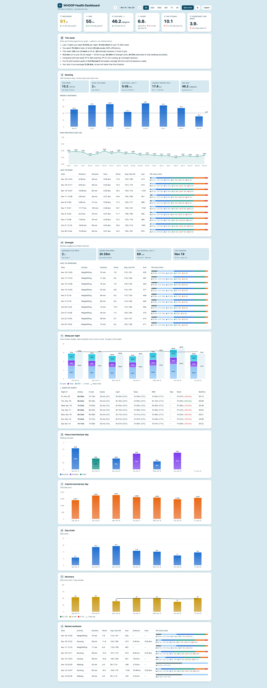

# WHOOP Dashboard + MCP

A self-hosted web app that pulls my WHOOP wearable data every morning, stores it, and shows it on a password-protected dashboard. It also exposes the same data to Claude through an MCP server, so I can ask questions like "how did my sleep compare to last month?" in plain language.

Built as a side project to learn three things end to end: working with a real OAuth API, deploying a small always-on service, and building an MCP server that an AI assistant can use.

<p align="center"></p>
<p align="center"><sub>Shown with generated sample data (<code>scripts/seed_demo.py</code>), not real health data.</sub></p>

## What it does

- **Daily sync.** At 9:00 every morning the app pulls recovery, sleep, strain and workouts from the WHOOP API into a local SQLite database. A **Sync now** button does the same on demand.
- **Dashboard.** A single page built around two questions: *am I sleeping enough?* and *am I training the way I planned?* Details in [What the dashboard shows](#what-the-dashboard-shows) below.
- **Ask Claude about it.** An MCP endpoint with seven tools: summary over N days, weekly rows, per-day rows, workouts, VO2 max entry, sync status, and trigger a sync. Connect it to Claude (desktop, web or Claude Code) and the data becomes something you can converse with.
- **Private by design.** Single-password login, signed session cookie, lockout after repeated failures. The MCP endpoint uses its own bearer token. The only external host the app ever contacts is `api.prod.whoop.com`. Nothing is sent anywhere else.

## What the dashboard shows

The WHOOP app is excellent at today: today's recovery, last night's sleep, this workout. What I wanted was the week. How much have I actually slept, naps included? Have I done the runs and strength sessions I said I would? Is my pace improving? This dashboard reorganises the same data around those questions, with exact numbers rather than rings and scores, so that one screen answers them.

It's a work in progress. I use it daily and keep changing it as I learn what I actually look at, so expect the layout and metrics below to evolve.

**At the top: six tiles for where you stand right now**

| Tile | What it shows |
|---|---|
| Recovery | this morning's score, colored green/yellow/red, vs your 30-day average |
| HRV | this morning's HRV in ms, vs 30-day average |
| VO2 max | your latest value with the change since the previous entry (typed in from the app; the API doesn't expose it) |
| Sleep | last night's total hours asleep, naps included, against your sleep need |
| Day strain | yesterday's strain, vs 30-day average |
| Exercised this week | hours of training since Monday, walking excluded, vs last week |

**This week: plain-language insights.** Average sleep per night over the last 7 nights and how far from your need; time in bed vs awake; runs done out of your weekly goal, strength sessions out of goal, kilometres run out of your target and what's left; total exercise vs last week; how many recent weeks hit both session goals; whether your last four runs were faster or slower than the eight before.

**Running.** Built for a training block (mine is a half marathon). Kilometres this week against a target, runs this week against a goal, average pace over your last four runs, longest recent run, VO2 max. A weekly-distance chart with the goal line, a pace-per-run chart with every run dated, and a table of the last ten runs: distance, duration, pace, strain, average and max heart rate, calories, and exact minutes spent in each heart-rate zone.

**Strength.** Sessions this week against a goal, hours this week, average session length and strain, and the last ten sessions with the same per-zone minutes. (WHOOP's API doesn't carry sets, reps or weights, so this is time, effort and heart rate.)

**Day by day, for any 7-, 30- or 90-day window.** Step backwards and forwards through your history with the ‹ › buttons.

- **Sleep per night.** Two bars per night: hours asleep, stacked into light, deep and REM, next to hours in bed. The gap between them is time awake. A dashed line marks your sleep need. Every segment is labeled, and a table underneath gives each night in hours and minutes with each stage as a percentage of total sleep, nap time, and minutes over or under need.
- **Hours exercised per day**, stacked by running, strength and other. Walking is excluded on purpose.
- **Calories burned per day**, **day strain** and **recovery** as daily bars with values on top.
- **Recent workouts**: everything in the window, with calories, distance, pace where it applies, and heart-rate zone minutes.

**Goals are yours to set.** Weekly run count, strength count and kilometres are environment variables, as are which WHOOP activity names count as running, strength or walking.

**What's deliberately not here.** No HRV-vs-resting-heart-rate chart, no strain-vs-next-day-recovery scatter, no recovery-by-weekday. The app shows those well enough already. The point of this page is the week's sleep and training, in numbers.

## How it's built

```
Browser ──login──▶ FastAPI app ──▶ SQLite (one file on a persistent volume)
                      │  ▲
Claude ──MCP/HTTP─────┘  │  scheduler (APScheduler, daily cron)
                         │
                   WHOOP API (OAuth 2.0, paginated REST)
```

| Piece | Choice | Why |
|---|---|---|
| Backend | Python, FastAPI, uvicorn | Small, typed, async-ready; one process does web + scheduler + MCP |
| Storage | SQLite on a Fly.io volume | Single user, a few MB a year; zero ops |
| Frontend | One HTML file, vanilla JS, inline SVG charts | No build step; the whole UI is readable in one sitting |
| Scheduling | APScheduler in-process | No separate worker or cron host to keep alive |
| MCP | Official `mcp` Python SDK, streamable HTTP | Mounts into the same FastAPI app; bearer-token gated |
| Hosting | Fly.io, single shared-CPU machine | Always-on for the scheduler; ~$2–3/month |

About 1,100 lines of Python and HTML in total, including tests. No JavaScript framework, no ORM, no message queue.

### Things worth noting in the code

- **Token rotation.** WHOOP rotates the refresh token on every refresh. The client always persists the newest one, and if a refresh fails it flips the app to a "Reconnect WHOOP" state instead of silently failing every morning.
- **Overlapping sync window.** WHOOP re-scores recent sleeps after the fact, so each sync re-pulls the last 7 days rather than only new records. Upserts make this idempotent.
- **Single-flight sync.** A lock ensures the cron job and the Sync now button can never run two syncs at once.
- **Tests without the real API.** The WHOOP API is mocked with `httpx.MockTransport`, so the suite covers pagination, token refresh, lockout, cookie tampering and MCP auth in half a second, offline.
- **Sample-data mode.** `scripts/seed_demo.py` fills the database with 180 days of plausible data so the dashboard can be previewed, demoed or screenshotted without any real health data.

## Run it yourself

If you have a WHOOP, you can run this for your own data. It takes about 15 minutes; nothing about it is specific to me.

1. Create a (free) WHOOP developer app at https://developer-dashboard.whoop.com to get a Client ID and Secret.
2. Clone this repo, copy `.env.example` to `.env`, fill in the values.
3. `uv pip install -r requirements.txt` (or plain `pip`), then `uvicorn app.main:app --port 8080`.
4. Open http://localhost:8080, sign in, click **Connect WHOOP**.

To keep it running permanently, [SETUP.md](SETUP.md) walks through hosting it on your own server (Docker or systemd, with HTTPS via Caddy), on Fly.io, or on a PaaS, plus how to point Claude at the MCP endpoint and troubleshooting. Ready-made config files are in `deploy/`.

If you don't have a WHOOP, `python scripts/seed_demo.py` gives you a dashboard full of sample data to click around in.

## Project layout

```
app/
  main.py        routes, login, OAuth callback, scheduler startup, MCP mount
  auth.py        password check, signed cookie, lockout
  whoop.py       WHOOP API client and the sync job
  db.py          SQLite schema and helpers
  payload.py     turns rows into the JSON the dashboard and MCP tools use
  mcp_server.py  the five MCP tools and the bearer-token gate
  templates/     dashboard.html, login.html
scripts/seed_demo.py   sample data generator
tests/                 15 tests, mocked WHOOP API
Dockerfile, fly.toml   container build and Fly.io config
deploy/                systemd unit, Caddyfile, docker-compose for self-hosting
SETUP.md               step-by-step setup and hosting guide
```

## What I'd do next

- Body measurements and skin temperature trends (the scope is already requested, the charts aren't built).
- Weekly email or Slack digest generated from the same summary the MCP tool returns.
- Multi-user support, if anyone other than me wanted to use one deployment.

## Privacy note

See [PRIVACY.md](PRIVACY.md) for the short version suitable for the WHOOP developer form. This app handles personal health data. It's designed for one person running their own instance: your data stays in your database, on your server, behind your password. Please don't point a shared deployment at other people's WHOOP accounts without thinking through consent and access.

---

Built with Python 3.12, FastAPI, SQLite and the MCP Python SDK. Developed with help from Claude Code. MIT licensed; see [LICENSE](LICENSE).
